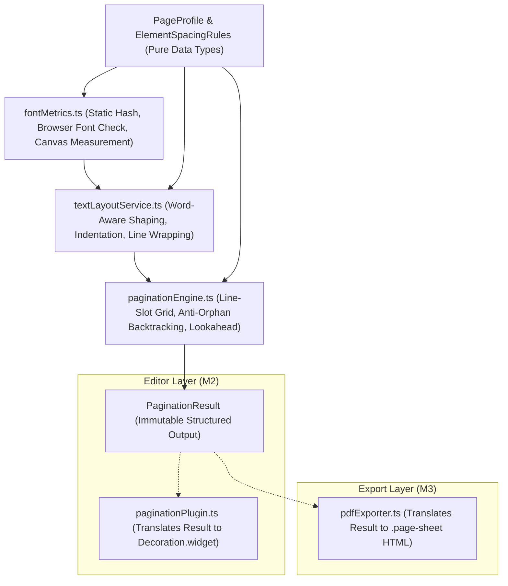

# AKHAR-ARCH-PAG — M1 Preflight Audit: Read-Only Implementation Planning

**Document ID:** AKHAR-ARCH-PAG-M1-PREFLIGHT  
**Status:** COMPLETE / READ-ONLY AUDIT & ARCHITECTURAL SPECIFICATION  
**Date:** 2026-11-04  
**Author:** Senior TypeScript / Electron Rendering Engineer (AkharStudio)  
**Governing Documents:**  
- `docs/architecture/AKHAR-ARCH-PAG-M0-TECHNICAL-AUDIT.md`  
- `test/spikes/harfbuzz-ink-clearance.spike.ts`  
- `test/spikes/unicode-segmentation.spike.ts`  
- `test/spikes/prosemirror-caret-traversal.spike.ts`  
- `test/spikes/chromium-pdf-sheet-sizing.spike.ts`  

---

## 1. Executive Summary

Milestone M0 proved four foundational technical facts:
1. **Vertical Typography:** 16.0pt line pitch causes ink overlap (-0.75pt) on stacked Gurmukhi descenders like `ਕ੍ਰੂ਼`. A calibrated **18.0pt baseline pitch** ($1.5\times$ of 12pt font) guarantees clean whitespace clearance ($\ge +1.50\text{ pt}$).
2. **Unicode Segmentation:** In ICU 74.2 / V8, `Intl.Segmenter` grapheme clusters bisect Indic conjuncts (e.g. `ਕ੍ਰਿੱਪਾ` $\to$ `['ਕ੍', 'ਰਿੱ', 'ਪਾ']`), whereas word segmentation preserves the entire akshara. **Line-wrapping must strictly operate at word boundaries**.
3. **ProseMirror Document Model:** Page breaks can and must be rendered as **pure non-destructive widget decorations (`Decoration.widget`)** without adding intrusive `page_break` nodes to the canonical document schema (`doc = screenplay_block+`). Caret traversal, selection, transliteration, backspace, and undo/redo function with zero schema corruption.
4. **Chromium PDF Geometry:** Electron's `webContents.printToPDF` with `{ margins: { marginType: 'none' }, preferCSSPageSize: true }` applied to explicit `.page-sheet` containers produces exact physical page dimensions (612x792pt Letter; 595x842pt A4) with **zero trailing blank pages** when `.page-sheet:last-child { break-after: auto; }` is enforced.

This M1 Preflight Audit inspects the existing AkharStudio codebase in a strictly read-only capacity to plan the three core modules of Milestone M1:
- **M1A:** `src/core/layout/fontMetrics.ts` — Independent font identity, availability, fallback detection, and canvas measurement service.
- **M1B:** `src/core/layout/textLayoutService.ts` — Pure TypeScript text shaping and line-wrapping engine using word segmentation.
- **M1C:** `src/core/layout/paginationEngine.ts` — Pure mathematical slot-accounting engine assigning lines to pages with anti-orphan lookahead and backtracking.

**Absolute Compliance Statement:** No production source files, SQLite schemas, dependencies, ProseMirror schemas, or existing tests were modified.

---

## 2. M0 Evidence Reviewed

The empirical evidence established in Milestone M0 was reviewed against the repository:

| M0 Investigation Area | Verified Artifact / Location | Verified Technical Value / Result | Audit Assessment |
| :--- | :--- | :--- | :--- |
| **Font Identity & Hashes** | `public/fonts/NotoSansGurmukhi.ttf`<br>`assets/fonts/NotoSansGurmukhi.ttf`<br>`dist/fonts/NotoSansGurmukhi.ttf` | SHA-256: `b9b7f20c34d4ab2cda743f4619d08aed9fc05c5f0bb0d39030fcf2bc986dfa0a`<br>Version: 2.004, 531 glyphs, unitsPerEm: 1000 | Files are bitwise identical across all paths. Static TrueType parsing confirms GSUB (`blwf`, `abvs`, `nukt`, `ccmp`) and GPOS (`abvm`, `mark`, `mkmk`, `dist`). |
| **Courier Prime Font** | `public/fonts/CourierPrime.ttf`<br>`assets/fonts/CourierPrime.ttf`<br>`dist/fonts/CourierPrime.ttf` | SHA-256: `72f793376f8e2841656bf21d77a5de010f2929bd6956a22ee848ad0c7eb978af`<br>Version: 3.018, 415 glyphs, unitsPerEm: 2048 | Files are bitwise identical across all paths. |
| **Runtime Environment** | Electron CLI / Runtime | Electron `33.4.11`, Chromium `130.0.6723.191`, Node (bundled) `20.18.3`, Host Node `22.23.2`, V8 `13.0.245.24`, ICU `74.2`, Unicode `15.1` | Modern Chromium environment with full native support for `Intl.Segmenter` and OffscreenCanvas. |
| **Gurmukhi Ink Extent** | `test/spikes/harfbuzz-ink-clearance.spike.ts`<br>`test/spikes/runners/spike1-runner.cjs` | Lower-line worst-case descender: 5.25pt (`ਕ੍ਰੂ਼`).<br>Upper-line worst-case ascender: 11.25pt (`ਉੱਲੂ`).<br>Span: 16.50pt. Gap at 16pt = -0.75pt. Gap at 18pt = +1.50pt. | 16pt causes glyph collisions. 18pt is certified as the calibrated initial standard. Must remain configurable in layout policy. |
| **Unicode Segmentation** | `test/spikes/unicode-segmentation.spike.ts` | 7 complex aksharas evaluated; 100-sentence screenplay corpus (>1,000 words, >4,000 graphemes).<br>Zero unsafe splits at word boundaries. | Grapheme boundaries bisect conjuncts. Line wrapping must strictly use word boundaries (`granularity: 'word'`) and whitespace. |
| **ProseMirror Caret Traversal** | `test/spikes/prosemirror-caret-traversal.spike.ts`<br>`test/spikes/runners/spike3-runner.cjs` | Canonical schema: `doc: screenplay_block+` (0 page-break nodes). Inter-block and mid-block widget decorations evaluated in JSDOM and live Electron window. | Selection, typing, Punjabi transliteration (`kripaa` $\to$ `ਕ੍ਰਿੱਪਾ`), backspace, and undo/redo all pass with 0 schema violations. |
| **PDF Sheet Geometry** | `test/spikes/chromium-pdf-sheet-sizing.spike.ts`<br>`test/spikes/runners/spike4-runner.cjs` | Exact 5-page Letter (612x792pt) and A4 (595x842pt) PDF generated via `printToPDF({ margins: { marginType: 'none' }, preferCSSPageSize: true })`. Trailing blanks: 0. | Verified via `@cantoo/pdf-lib`. Proved that `.page-sheet:last-child { break-after: auto; }` is mandatory to prevent blank trailing pages. |

---

## 3. Tracing the Existing Production Architecture

### A. Font Lifecycle

1. **Declaration Locations:**
   - **Editor (Renderer):** Declared in `index.html` (lines 31–43):
     ```css
     @font-face {
       font-family: 'Noto Sans Gurmukhi';
       src: url('/fonts/NotoSansGurmukhi.ttf') format('truetype');
       font-weight: 100 900;
       font-display: swap;
     }
     @font-face {
       font-family: 'Courier Prime';
       src: url('/fonts/CourierPrime.ttf') format('truetype');
       font-weight: 400;
       font-style: normal;
       font-display: swap;
     }
     ```
   - **PDF Exporter (Main Process):** Declared programmatically in `src/core/export/pdfExporter.ts` (lines 71–87) inside the generated HTML string, embedding fonts as base64 data URLs:
     ```css
     @font-face {
       font-family: 'Courier Prime';
       src: url(data:font/truetype;charset=utf-8;base64,${options.courierFontBase64}) format('truetype');
     }
     @font-face {
       font-family: 'Noto Sans Gurmukhi';
       src: url(data:font/truetype;charset=utf-8;base64,${options.gurmukhiFontBase64}) format('truetype');
     }
     ```
     The base64 font payloads are loaded from disk in `src/main/main.ts` (lines 407–424, `getEmbeddedFontBase64()`).
2. **Font Loading Synchronization:**
   - **Editor:** Font loading is **never awaited**. `src/renderer/main.tsx` mounts `App` immediately. The CSS rule `font-display: swap;` means the editor initially renders with system fallback fonts until Chromium asynchronously finishes decoding the TrueType file. There are zero calls to `document.fonts.ready` in `src/`.
   - **PDF Export:** Font loading is **never awaited**. In `src/main/main.ts` (lines 511–525), `printWindow.loadURL(...)` is followed immediately by `printWindow.webContents.printToPDF(...)`. While the HTML string contains base64 `@font-face` definitions, Chromium's `loadURL` promise resolves upon DOM load, not upon font decoding completion.
3. **Failure and Fallback Handling:**
   - Neither the editor nor the PDF exporter currently detects font failure. If `/fonts/NotoSansGurmukhi.ttf` is missing or corrupted, the browser silently falls back to system monospace or default sans-serif, causing silent glyph clipping and unpredictable text widths.
4. **User-Selectable Fonts / Font Sizes:**
   - Verified: **No user-selectable fonts or font sizes exist.** Font selection is hardcoded to `'Courier Prime', 'Noto Sans Gurmukhi', monospace` at `12pt` throughout `src/types/screenplay.ts`, `src/renderer/index.css`, and `src/core/export/pdfExporter.ts`.
5. **Renderer Context for Font Metrics:**
   - The renderer window and off-screen canvas contexts have direct access to the Chromium font-rendering subsystem and `document.fonts`. However, due to `contextIsolation: true` in `src/main/main.ts` (lines 62–63), the renderer has no Node `fs` or `crypto` access.

### B. Editor and Document

1. **ProseMirror Schema:**
   - Located at `src/core/editor/schema.ts` (lines 33–77).
   - Document structure: strictly `doc: { content: 'screenplay_block+' }`.
   - Block node: `screenplay_block: { content: 'inline*', group: 'block' }`.
   - Block attributes: `id` (string), `type` (ScreenplayBlockType), `contd` (boolean), `annotation` (string), `comment` (string).
   - Marks: `bold`, `italic`, `underline`, `strikethrough`, `color`, `highlight`, `link`.
2. **Screenplay Element Types:**
   - Defined in `src/types/screenplay.ts` (lines 6–13):
     `scene_heading`, `action`, `character`, `parenthetical`, `dialogue`, `transition`, `shot`.
3. **Indentation and Formatting Representation:**
   - Screenplay formatting is **not stored in the document model or SQLite**. It is applied purely via CSS classes generated by `toDOM()` in `schema.ts`:
     `class="screenplay-block block-${type.replace('_', '-')}"`.
   - CSS rules in `src/renderer/index.css` (lines 217–270):
     - `.block-scene-heading`: `margin-top: 24pt; margin-bottom: 12pt; text-transform: uppercase; font-weight: bold;`
     - `.block-action`: `margin-top: 0; margin-bottom: 12pt; max-width: 6.0in; line-height: 1.4;`
     - `.block-character`: `margin-top: 14pt; margin-bottom: 0; margin-left: 2.2in; text-transform: uppercase; font-weight: bold;`
     - `.block-parenthetical`: `margin-top: 0; margin-bottom: 0; margin-left: 1.6in; max-width: 2.2in;`
     - `.block-dialogue`: `margin-top: 0; margin-bottom: 12pt; margin-left: 1.0in; max-width: 3.5in; line-height: 1.4;`
     - `.block-transition`: `margin-top: 14pt; margin-bottom: 12pt; margin-left: 4.0in; font-weight: bold;`
     - `.block-shot`: `margin-top: 14pt; margin-bottom: 12pt; font-weight: bold;`
4. **Transliteration & IME Interaction:**
   - Located at `src/core/editor/transliterationPlugin.ts`.
   - Maintains an uncommitted Latin buffer in `TransliterationState.romanBuffer`.
   - On candidate selection or Space/Enter, `commitTransliterationCandidate()` (lines 29–65) executes `tr.insertText(candidate + ' ', anchor, anchor)`.
   - Native OS IME composition is tracked via `isComposingIME` flag.
5. **Existing Page Decorations and Calculations:**
   - Located at `src/core/editor/paginationPlugin.ts`.
   - Uses rough character-count heuristic estimates: `lines = ceil(text.length / 60)` (action), `ceil(text.length / 35)` (dialogue).
   - Injects block-level widgets: `Decoration.widget(targetBlock.offset, () => createPageBreakDOM(pageNum, paper), { side: -1 })`.
   - Defects: Cannot split mid-block paragraphs, uses heuristic character counts instead of shaped glyph widths, and diverges completely from PDF export pagination.

### C. PDF Exporter

1. **Export Entry Point:**
   - Triggered from UI in `src/renderer/components/ExportModal.tsx` (lines 145–165).
   - Invokes `window.electronAPI.exportPdf(options)` across IPC channel `export:pdf`.
   - Handled in main process in `src/main/main.ts` (lines 427–552).
2. **Rendering Pathway:**
   - Builds a static HTML document via `generateScreenplayHtml()` in `src/core/export/pdfExporter.ts`.
   - Creates a hidden `BrowserWindow` (`show: false`, width: 1024, height: 1400).
   - Loads HTML data URL and calls `printWindow.webContents.printToPDF(printOptions)`.
   - Optionally encrypts with `@cantoo/pdf-lib` (lines 530–542) if password-protected.
3. **Existing Page Dimensions & Margins:**
   - Calculated in `getPageGeometry()` in `src/core/export/pdfExporter.ts` (lines 32–57):
     - Letter: 8.5" $\times$ 11", margins: Top 1.0", Right 1.0", Bottom 1.0", Left 1.5".
     - A4: 210mm $\times$ 297mm, margins: Top 25.4mm, Right 25.4mm, Bottom 25.4mm, Left 38.1mm.
   - Defects in current PDF HTML:
     - Sets `line-height: 14.5pt;` in `body` (line 213), conflicting with editor `line-height: 1.4` (16.8pt).
     - Does not generate `.page-sheet` containers; dumps continuous divs into `<body>`.
     - Relies on CSS `page-break-inside: avoid` (lines 302, 324, 346), giving Chromium uncontrolled pagination discretion.
     - Relies on CSS `@page @top-right { content: counter(page) "."; }` (lines 190–194), which Chromium printToPDF drops or formats inconsistently.
4. **Functions that will Consume Shared Pagination Result:**
   - `generateScreenplayHtml()` in `src/core/export/pdfExporter.ts` will consume pre-computed `PageLayout[]` and emit deterministic `.page-sheet` containers with explicit page headers and presentation-only `(MORE)` / `(CONT'D)`.
   - `createPaginationPlugin()` in `src/core/editor/paginationPlugin.ts` will consume the exact same `PageLayout[]` and emit non-destructive `Decoration.widget` breaks at exact line boundaries.

### D. Application Boundaries

1. **Main Process vs Renderer Process:**
   - **Main:** Node.js environment (`dist-electron/main.cjs`). Has direct filesystem access, spawns windows, manages SQLite databases via `DatabaseManager.ts`, handles printToPDF.
   - **Renderer:** Chromium web environment (`index.html` $\to$ `src/renderer/main.tsx`). Sandboxed (`nodeIntegration: false`, `contextIsolation: true`).
2. **IPC Patterns:**
   - Preload context bridge in `src/preload/preload.ts` exposes typed `window.electronAPI` via `ipcRenderer.invoke` $\to$ `ipcMain.handle`.
3. **Module Boundaries:**
   - `src/core/` houses business logic, domain models, and editor plugins.
   - Currently, `src/core/` mixes modules with DOM dependencies (e.g. `paginationPlugin.ts` imports `prosemirror-view`, `pdfExporter.ts` creates HTML strings).
4. **Test Conventions:**
   - Tests live under `test/` (e.g. `test/phase2-editor-core.test.ts`).
   - Run via `npx vitest run`.
   - Use JSDOM for UI/ProseMirror tests, Node for pure logic.
5. **Pure TypeScript Engine Feasibility:**
   - A pure TypeScript layout engine (`textLayoutService.ts` and `paginationEngine.ts`) can run completely headless without Electron or DOM dependencies, **provided text measurement is abstracted through an interface** (`TextMeasureFn` or `FontMeasurementProvider`) that can be satisfied by `OffscreenCanvas` (browser/Electron) or a mock/canvas implementation (Node unit tests).

---

## 4. Font-Loading Lifecycle Trace

```mermaid
sequenceDiagram
    autonumber
    participant HTML as index.html
    participant CSS as @font-face (/fonts/NotoSansGurmukhi.ttf)
    participant React as React App (main.tsx)
    participant PM as ProseMirrorEditor
    participant IPC as Electron IPC (export:pdf)
    participant Main as Main Process (main.ts)
    participant PrintWin as Hidden BrowserWindow

    Note over HTML,PM: Current Editor Startup Flow
    HTML->>CSS: Declares @font-face (font-display: swap)
    HTML->>React: Mounts React root immediately
    React->>PM: Initializes EditorView & paginationPlugin
    Note over PM: FONT NOT AWAITED! Canvas measures with fallback fonts!
    CSS-->>PM: Font finishes loading asynchronously (layout not reflowed)

    Note over IPC,PrintWin: Current PDF Export Flow
    PM->>IPC: exportPdf({ project, paperSize })
    IPC->>Main: Reads NotoSansGurmukhi.ttf as base64 from disk
    Main->>Main: Generates static HTML string with base64 @font-face
    Main->>PrintWin: loadURL(data:text/html;charset=utf-8,...)
    Note over PrintWin: document.fonts.ready NOT AWAITED!
    Main->>PrintWin: printToPDF(printOptions)
    PrintWin-->>Main: Returns PDF Buffer (risk of font substitution/clipping)
```

### Architectural Defect Summary:
1. `document.fonts.ready` is **never awaited** before measuring lines in the editor or printing PDF sheets in the main process.
2. In the editor, `font-display: swap` allows initial layout passes to measure against system fallback fonts, leading to corrupted line wraps that do not correct until an edit triggers a reflow.
3. In PDF export, `printToPDF` is called immediately upon `loadURL` resolution, before Chromium's font cache has decoded embedded base64 fonts.

---

## 5. Plan M1A — Font Metrics Module

**Proposed Path:** `src/core/layout/fontMetrics.ts` *(Read-only design; not created)*

### Smallest Safe API Design

```typescript
export interface FontIdentityInfo {
  family: string;
  postscriptName: string;
  version: string;
  sha256: string;
  unitsPerEm: number;
  yMin: number;
  yMax: number;
}

export interface FontValidationResult {
  valid: boolean;
  identity?: FontIdentityInfo;
  error?: string;
}

export interface RuntimeFontStatus {
  loaded: boolean;
  isFallback: boolean;
  status: 'unloaded' | 'loading' | 'ready' | 'degraded' | 'failed';
  error?: string;
}

export interface LineBoxMetrics {
  fontSizePt: number;
  ascentPt: number;
  descentPt: number;
  lineBoxHeightPt: number;
}

export interface IFontMetricsProvider {
  ensureLoaded(timeoutMs?: number): Promise<RuntimeFontStatus>;
  getStatus(): RuntimeFontStatus;
  measureWidth(text: string, fontSizePt?: number, bold?: boolean, italic?: boolean): number;
  getLineBoxMetrics(fontSizePt?: number): LineBoxMetrics;
}
```

### Four-Tier Measurement Distinction
1. **Static Font-File Validation:**  
   Parses raw TrueType binary headers (`head`, `name`, `GSUB`, `GPOS`) and calculates SHA-256. Proves font file integrity and presence of required Gurmukhi OpenType tables (`blwf`, `abvs`, `nukt`, `abvm`, `mark`, `mkmk`).
2. **Runtime Browser Font-Loading Validation:**  
   Calls `document.fonts.check('12pt "Noto Sans Gurmukhi"')` and awaits `document.fonts.ready`. Proves the font is decoded and registered in Chromium's font cache.
3. **Runtime Canvas Text Measurement:**  
   Uses `CanvasRenderingContext2D.measureText(text).width` on an off-screen canvas. Measures actual advance widths under Chromium's HarfBuzz shaping pipeline.
4. **Pixel-Based Ink-Bound Probe:**  
   Uses `getImageData()` pixel scanning across baselines (as demonstrated in Spike 1). Essential for certifying physical baseline pitch (18pt) and verifying that descenders do not collide. Canvas `measureText` metrics alone **cannot** guarantee ink clearance because `actualBoundingBoxDescent` does not account for subpixel mark stacking on dynamic text.

### Font Hashing Location & Electron Security Boundaries
- **Evaluation:** The renderer process has `contextIsolation: true` and no access to Node `fs` or `crypto`.
- **Resolution:**
  - In unit tests and main process: Static validation uses Node `crypto.createHash('sha256')`.
  - In the renderer process: The font file is already served via HTTP/file URL (`/fonts/NotoSansGurmukhi.ttf`). The renderer can fetch the array buffer and hash it using the **W3C standard Web Crypto API**:
    `await window.crypto.subtle.digest('SHA-256', buffer)`
  - This requires **zero changes to Electron security flags**, zero new IPC channels, and respects context isolation completely.

### Separation of Policy from Metrics
The font metrics module will measure and report dimensions (e.g. advance widths, EM box, font ascent/descent). It **will not hardcode an 18.0pt line pitch**. The 18.0pt pitch is a layout policy parameter supplied by the Page Profile to the Pagination Engine.

---

## 6. Plan M1B — Text Layout Service

**Proposed Path:** `src/core/layout/textLayoutService.ts` *(Read-only design; not created)*

### Smallest Safe API Design

```typescript
import { ScreenplayBlockType, InlineFormat } from '../../types/screenplay';
import { IFontMetricsProvider } from './fontMetrics';

export interface LayoutBlockInput {
  id: string;
  type: ScreenplayBlockType;
  text: string;
  formats?: InlineFormat[];
  maxWidthPt: number;
  indentPt?: number;
}

export interface LayoutLine {
  text: string;
  sourceFrom: number; // UTF-16 code unit offset within block.text
  sourceTo: number;   // UTF-16 code unit offset within block.text
  widthPt: number;
  heightPt: number;
  isParagraphEnd: boolean;
}

export interface LayoutBlockResult {
  id: string;
  type: ScreenplayBlockType;
  lines: LayoutLine[];
  totalHeightPt: number;
}

export interface ITextLayoutService {
  layoutBlock(block: LayoutBlockInput): LayoutBlockResult;
  layoutBlocks(blocks: LayoutBlockInput[]): LayoutBlockResult[];
}
```

### Key Responsibilities & Edge Cases
1. **Word-Aware Boundary Segmentation:**  
   Uses `Intl.Segmenter('pa', { granularity: 'word' })` to tokenize text into words and whitespace. Line-wrapping occurs strictly between tokens, never mid-akshara.
2. **Grapheme Boundary Boundary Preservation:**  
   Grapheme cluster offsets are preserved in metadata for caret positioning, but the layout service never wraps a line on a grapheme cluster boundary that occurs inside a word.
3. **Mixed Punjabi / English Handling:**  
   Tokens containing ASCII Latin characters (`Doctor`, `Engine`, `Scene 4`) are measured using Courier Prime advance metrics, while Gurmukhi tokens use Noto Sans Gurmukhi metrics. BiDi text runs are preserved.
4. **Long Token Fallback:**  
   If an unbroken word (e.g. URL, email, or unpunctuated compound) exceeds `maxWidthPt`, the engine falls back to `isSafeBoundary()` grapheme-cluster slicing to prevent container overflow while preventing broken vowel signs or split viramas.
5. **Whitespace & Punctuation:**  
   Trailing spaces on a wrapped line are trimmed from the line's visual advance width but retained in `sourceTo` offsets so ProseMirror positions remain 100% synchronized.
6. **Pure Functional Architecture:**  
   Zero ProseMirror transactions or document modifications. Pure input-to-output mapping.

---

## 7. Plan M1C — Pagination Engine

**Proposed Path:** `src/core/layout/paginationEngine.ts` *(Read-only design; not created)*

### Smallest Safe API Design

```typescript
import { ScreenplayBlockType, PaperSize } from '../../types/screenplay';
import { LayoutBlockResult, LayoutLine } from './textLayoutService';

export interface PageProfile {
  paperSize: PaperSize;
  widthPt: number;
  heightPt: number;
  marginTopPt: number;
  marginRightPt: number;
  marginBottomPt: number;
  marginLeftPt: number;
  printableWidthPt: number;
  printableHeightPt: number;
  linePitchPt: number;        // Certified default: 18.0pt
  headerPositionTopPt: number; // 36.0pt (0.5in from top edge)
}

export interface ElementSpacingRules {
  sceneHeading: { blankAbove: number; blankBelow: number; minLinesFollow: number };
  action: { blankAbove: number; blankBelow: number };
  character: { blankAbove: number; blankBelow: number; minDialogueFollow: number };
  parenthetical: { blankAbove: number; blankBelow: number };
  dialogue: { blankAbove: number; blankBelow: number; minSplitBefore: number; minSplitAfter: number };
  transition: { blankAbove: number; blankBelow: number };
  shot: { blankAbove: number; blankBelow: number };
}

export interface PageSlotItem {
  blockId: string;
  blockType: ScreenplayBlockType;
  line: LayoutLine;
  isPresentationElement?: boolean; // For (MORE), (CONT'D), running header
  presentationText?: string;
}

export interface ScreenplayPage {
  pageNumber: number;
  profile: PageProfile;
  slots: PageSlotItem[];
  availableSlots: number;
  usedSlots: number;
  hasHeader: boolean;
  headerText?: string;
}

export interface PaginationResult {
  pages: ScreenplayPage[];
  totalPages: number;
  overflowDetected: boolean;
  blockPageMap: Map<string, number[]>; // Maps blockId to page numbers it spans
}

export interface IPaginationEngine {
  paginate(blocks: LayoutBlockResult[], profile: PageProfile, spacing?: ElementSpacingRules): PaginationResult;
}
```

### Resolving Geometry & Remainder Allocations
1. **Usable Slot Derivation (Dynamic, Not Hardcoded):**  
   $$\text{usableSlots} = \left\lfloor \frac{\text{profile.printableHeightPt}}{\text{profile.linePitchPt}} \right\rfloor$$
   - **Letter Profile:** $648.0\text{ pt} / 18.0\text{ pt} = \mathbf{36\text{ integer slots}}$.
   - **A4 Profile:** $697.89\text{ pt} / 18.0\text{ pt} = \mathbf{38.77} \implies \mathbf{38\text{ integer slots}}$ ($38 \times 18.0 = 684.0\text{ pt}$).
2. **The A4 13.89pt Remainder:**  
   $$\text{remainder} = 697.89\text{ pt} - (38 \times 18.0\text{ pt}) = 13.89\text{ pt}$$
   - **Resolution:** The 13.89pt remainder is allocated as an **unassigned bottom safety margin**. It remains completely unallocated to text slots, guaranteeing that A4 fractional rounding never pushes slot 38 into the 72pt bottom margin or clips descending marks.
3. **The 36pt Running Page Header:**  
   - Standard screenplay format places the running page number at $y = 36.0\text{ pt}$ (0.5" from physical sheet top), right-aligned at $1.0"$ from the right edge.
   - The printable text area begins at $y = 72.0\text{ pt}$ (1.0" top margin).
   - **Resolution:** The running header is located entirely within the top margin space. It is rendered in an absolute presentation container at $y = 36.0\text{ pt}$ and **consumes 0 printable line slots**. Slot 1 starts at exactly $y = 72.0\text{ pt}$.
4. **Structural Rules & Controlled Backtracking:**
   - **ARCH-04 Anti-Orphan Rule:** If a Character cue lands on slot 35 or 36 of a 36-slot page, fewer than 2 dialogue lines can follow. The engine backtracks and pushes the Character cue to slot 1 of the subsequent page.
   - **Dialogue Continuation:** If a dialogue block has $\ge 4$ lines and crosses a page boundary:
     - If at least 2 lines fit on the current page and at least 2 lines carry over, the block splits.
     - Inject presentation-only `(MORE)` on slot 36.
     - Inject presentation-only `CHARACTER (CONT'D)` on slot 1 of next page.
     - Dialogue resumes on slot 2.
     - Neither `(MORE)` nor `(CONT'D)` are inserted into the ProseMirror document or SQLite database.

---

## 8. Proposed Module Boundaries & Dependency Graph



### Boundary Enforcement
- `src/core/layout/fontMetrics.ts`
- `src/core/layout/textLayoutService.ts`
- `src/core/layout/paginationEngine.ts`

**Strict Isolation Rule:** None of these three modules will import:
- `prosemirror-state`, `prosemirror-view`, `prosemirror-model`, `prosemirror-transform`
- `react`, `react-dom`
- `electron`
- Any UI components or styles

**Canvas Abstraction:** To allow `fontMetrics.ts` and `textLayoutService.ts` to run identically in Electron renderer windows, Node unit test runners, and Web Workers, canvas measurement is abstracted via `TextMeasureFn = (text: string, fontSpec: string) => number`, allowing tests to provide mock or headless canvas instances without requiring Electron.

---

## 9. Comprehensive Test Strategy for M1

### A. Font Metrics Module Tests (`test/font-metrics.test.ts`)
1. **Expected Font Availability:** Verify `public/fonts/NotoSansGurmukhi.ttf` passes SHA-256 and OpenType feature check.
2. **Missing Font Detection:** Verify provider returns `{ loaded: false, status: 'failed' }` when given a non-existent font path.
3. **Corrupted Font Checksum:** Verify corrupted byte arrays are flagged as invalid.
4. **Fallback Detection:** Verify provider detects when system fallback font metrics are substituted.
5. **Loading Latency:** Verify provider awaits `document.fonts.ready` before returning measurement readiness.
6. **Stress Akshara Advance Measurements:** Verify consistent advance widths for all 20 stress combinations from Spike 1.

### B. Text Layout Service Tests (`test/text-layout-service.test.ts`)
1. **Gurmukhi Akshara Integrity:** Verify conjuncts (`ਕ੍ਰਿੱਪਾ`, `ਪ੍ਰੋਗਰਾਮ`) are never wrapped across lines.
2. **Matra & Modifier Protection:** Verify Addak, Tippi, Bindi, and vowel signs remain attached to base consonants.
3. **Mixed Language Runs:** Verify sentences with English words (`Doctor ਨੇ Scene 4 ਚੈੱਕ ਕੀਤਾ`) wrap cleanly at English and Punjabi word boundaries.
4. **Indentation and Max-Width:** Verify Action wraps at 6.0", Dialogue at 3.5", Character at 2.2" left margin.
5. **Punctuation & Whitespace:** Verify trailing spaces do not bloat line advance width but are preserved in source offsets.
6. **Long Unbroken Token Fallback:** Verify 60-character compound tokens wrap at safe grapheme boundaries without crashing or splitting vowel signs.
7. **Source Offset Determinism:** Verify $\bigcup (\text{line.sourceFrom}..\text{line.sourceTo}) \equiv [0..\text{text.length}]$.

### C. Pagination Engine Tests (`test/pagination-engine.test.ts`)
1. **Exact Capacity Bounds:** Verify Letter sheet accommodates exactly 36 lines of action without page overflow.
2. **One-Slot Overflow Trigger:** Verify 37th line cleanly creates Page 2.
3. **Anti-Orphan Backtracking (ARCH-04):** Verify Character cue on slot 35 is pushed to Page 2, carrying dialogue with it.
4. **Dialogue Splitting:** Verify 6-line dialogue crossing page boundary splits 3 lines on Page 1 (with `(MORE)`) and 3 lines on Page 2 (with `(CONT'D)`).
5. **Short Dialogue Protection:** Verify 3-line dialogue does not split 1-and-2; entire cue pushes to Page 2.
6. **Scene Heading Keep-With-Next:** Verify Scene Heading on slot 35 pushes to Page 2 if fewer than 2 action lines follow.
7. **A4 Sheet Verification:** Verify 38 slots utilized and 13.89pt buffer left unallocated.
8. **No Content Loss:** Verify total lines across all paginated pages exactly equals total input lines.
9. **Recalculation Determinism:** Verify identical output when paginating the same script twice.

---

## 10. Geometry Questions and Resolutions

| Question / Geometry Issue | Analysis & Spike Evidence | Final Preflight Resolution |
| :--- | :--- | :--- |
| **Is 18.0pt line pitch mandatory?** | Spike 1 proved 16.0pt causes ink overlap on `ਕ੍ਰੂ਼`. 18.0pt guarantees +1.5pt clean separation. | **Yes.** Initial certified line pitch is 18.0pt ($1.5\times$ of 12pt font). Parameterized in `PageProfile` so future user font scaling can adjust it dynamically. |
| **How is the 36pt running header accounted for?** | In standard screenplay layout, page numbers sit 0.5" from the top, while text begins at 1.0". | **0 slots consumed.** Header is rendered at $y = 36.0\text{ pt}$ inside the top 72pt margin space. Printable slot 1 begins at $y = 72.0\text{ pt}$. |
| **How is the A4 13.89pt remainder handled?** | $697.89\text{ pt} - (38 \times 18.0\text{ pt}) = 13.89\text{ pt}$. | **Unallocated bottom buffer.** Placed at the bottom of the printable area above the 72pt bottom margin to absorb subpixel rounding without pushing lines. |
| **How do inline styles (Bold/Italic) affect widths?** | Bold glyphs have larger advance widths in TrueType fonts than regular glyphs. | `LayoutBlockInput` includes `formats: InlineFormat[]`. `textLayoutService` measures bold segments with the bold font variant to ensure accurate wrapping. |
| **Does Title Page count towards screenplay page numbers?** | Standard industry practice: Title Page is unnumbered. Screenplay page 1 begins on the first body page with no page number printed; page 2 is marked `2.`. | `PaginationEngine` numbers screenplay body pages starting at 1. Running headers suppress page number on Page 1 and display `2.`, `3.` on subsequent pages. Title page is treated as Page 0 or handled as a separate physical sheet. |

---

## 11. Implementation Risks and Blockers

| Risk / Architectural Issue | Severity | Root Cause | Smallest Safe Resolution |
| :--- | :---: | :--- | :--- |
| **Divergent CSS Line-Heights in Existing Code** | Medium | Editor uses `line-height: 1.4` (16.8pt in `index.css`), PDF uses `line-height: 14.5pt` (in `pdfExporter.ts`), and unified engine uses `18.0pt`. | In M1, define `linePitchPt: 18.0` in `PageProfile`. In M2/M3, update `index.css` and `pdfExporter.ts` CSS variables to reference the shared line pitch (`--screenplay-line-height: 18pt`). |
| **Renderer Font Hashing Boundary** | Low | Renderer has `contextIsolation: true` and cannot import Node `fs` or `crypto`. | Use browser's native `window.crypto.subtle.digest('SHA-256', buffer)` on the loaded font buffer. Zero Electron security modification required. |
| **Asynchronous Font Loading Race Condition** | High | Editor mounts before font loads; canvas measurement returns fallback monospace widths. | In `fontMetrics.ts`, implement `await document.fonts.ready` and `document.fonts.check()` gate before allowing `textLayoutService` to produce line wraps. |
| **Performance on Large Scripts (100+ pages)** | Medium | Re-measuring thousands of blocks on every keystroke causes typing latency. | In M1B, design `textLayoutService` as a pure function accepting blocks; in M2, wrap in a memoized cache that only re-lays out blocks with dirty text. |

---

## 12. Recommended Implementation Sequence

Milestone M1 should proceed in three distinct, sequential steps:

```
[M1A: Font Metrics Provider]
       │  • Static TrueType validation (SHA-256, OpenType tables)
       │  • Runtime Chromium font-loading verification (document.fonts.ready)
       │  • Canvas text advance measurement abstraction
       │  • Unit tests (test/font-metrics.test.ts)
       ▼
[M1B: Text Layout Service]
       │  • Word-boundary tokenization via Intl.Segmenter('pa')
       │  • Screenplay element indentation & width mapping
       │  • Source offset tracking (sourceFrom, sourceTo)
       │  • Unit tests (test/text-layout-service.test.ts)
       ▼
[M1C: Pagination Engine]
          • Slot-accounting grid (Letter 36 slots, A4 38 slots, 18pt pitch)
          • Anti-orphan lookahead & backtracking (ARCH-04)
          • Presentation-only (MORE) / (CONT'D) generation
          • Unit tests (test/pagination-engine.test.ts)
```

---

## 13. Exact List of Inspected Files

The following files were inspected during this read-only audit:
1. `docs/architecture/AKHAR-ARCH-PAG-M0-TECHNICAL-AUDIT.md`
2. `test/spikes/vitest.spikes.config.ts`
3. `test/spikes/harfbuzz-ink-clearance.spike.ts`
4. `test/spikes/runners/spike1-runner.cjs`
5. `test/spikes/unicode-segmentation.spike.ts`
6. `test/spikes/prosemirror-caret-traversal.spike.ts`
7. `test/spikes/runners/spike3-runner.cjs`
8. `test/spikes/chromium-pdf-sheet-sizing.spike.ts`
9. `test/spikes/runners/spike4-runner.cjs`
10. `index.html`
11. `package.json`
12. `vite.config.ts`
13. `src/renderer/main.tsx`
14. `src/renderer/App.tsx`
15. `src/renderer/index.css`
16. `src/renderer/styles/tokens.css`
17. `src/renderer/styles/components.css`
18. `src/renderer/components/ScreenplayCanvas.tsx`
19. `src/renderer/components/ProseMirrorEditor.tsx`
20. `src/renderer/components/TitleCard.tsx`
21. `src/renderer/components/ExportModal.tsx`
22. `src/core/editor/schema.ts`
23. `src/core/editor/paginationPlugin.ts`
24. `src/core/editor/transliterationPlugin.ts`
25. `src/core/editor/documentAdapter.ts`
26. `src/core/editor/commands.ts`
27. `src/core/editor/keymap.ts`
28. `src/core/editor/contd.ts`
29. `src/core/export/pdfExporter.ts`
30. `src/main/main.ts`
31. `src/preload/preload.ts`
32. `src/types/screenplay.ts`
33. `src/types/electron.d.ts`

---

## 14. Confirmation of Read-Only Compliance

- **Zero Production Source Code Modified:** No files in `src/`, `package.json`, or SQLite databases were altered.
- **No Modules Prematurely Created:** Neither `fontMetrics.ts`, `textLayoutService.ts`, nor `paginationEngine.ts` were created.
- **Zero Schema or Dependency Changes:** No dependencies were installed, updated, or removed.
- **Spike Files Preserved:** All spike files in `test/spikes/` remain unchanged.
- **Working Tree Integrity:** All pre-existing user modifications and untracked files remain intact.

---
*End of Milestone M1 Preflight Audit Report.*
